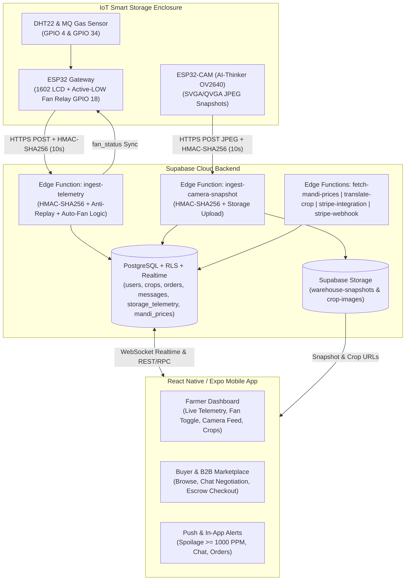

# AgroBridge 🌱

[](https://github.com/YashasR1/AgroBridge/releases/tag/v1.0.0)
[](agrobridge-app/package.json)
[](supabase_schema.sql)
[](agrobridge-gateway/agrobridge-gateway.ino)

AgroBridge is an IoT-enabled agricultural marketplace and smart cold-storage monitoring platform built with React Native (Expo), Supabase, ESP32, and ESP32-CAM. By eliminating middlemen, AgroBridge connects farmers directly with buyers and backs produce listings with live environmental telemetry, automated spoilage mitigation, warehouse camera snapshots, government Mandi price benchmarks, and escrow-protected orders.

> 📱 **Android App Release:** Download the latest prebuilt APK from the [GitHub Releases](https://github.com/YashasR1/AgroBridge/releases/latest) page (`AgroBridge-release.apk`).

---

## 📸 Smart Storage Hardware Prototype

The AgroBridge IoT unit is housed in a custom dual-compartment wooden enclosure that isolates the microcontroller electronics from the crop storage chamber while providing local status readouts and automated active ventilation.

### 1. Front Enclosure, 1602 LCD & Exhaust Fan


_Front exterior of the latched wooden storage unit featuring a panel-mounted 16×2 character LCD (displaying live temperature, humidity, gas PPM, fan state, and `AUTO`/`MANUAL` mode) alongside an automated exhaust cooling fan._

### 2. Dual-Compartment Interior (Electronics Bay & Storage Chamber)


_Top-down interior view showing the partitioned design: the upper compartment houses the controller and wiring, while the lower crop storage chamber contains the DHT22 temperature/humidity sensor, MQ gas sensor module for spoilage detection, and ventilation fan aperture._

### 3. Electronics Bay & Sensor Wiring Harness


_Inside the upper electronics compartment showing the ESP32 microcontroller, solderless breadboard distribution, and color-coded jumper harness routing to the front 1602 LCD, fan control relay (`GPIO 18`), and lower-chamber sensors._

---

## 1. System Architecture



### Subsystem Control Flow

1. **Sensing & Local Actuation (`agrobridge-gateway`):** Reads DHT22 temperature/humidity and MQ analog gas levels every 10 seconds, updates the local 1602 LCD, and enforces automatic fan activation (`GPIO 18`) whenever gas ≥ 1000 PPM, temperature ≥ 35.0°C, or humidity ≥ 80.0%.
2. **Visual Monitoring (`agrobridge-cam`):** Captures JPEG warehouse frames (SVGA `800×600` with PSRAM, QVGA fallback) every 10 seconds and uploads them to `ingest-camera-snapshot`, which stores the latest frame in Supabase Storage (`warehouse-snapshots`) and updates `storage_telemetry`.
3. **Authenticated Cloud Ingestion (`agrobridge-backend`):** Deno Edge Functions validate **HMAC-SHA256** signatures (`mbedtls_md` on ESP32 ↔ Web Crypto on Deno) and NTP Unix timestamps within a 300-second anti-replay window before writing to PostgreSQL.
4. **Realtime Mobile Experience (`agrobridge-app`):** Subscribes to Supabase Realtime channels for live telemetry, camera snapshot URLs, chat negotiation messages, and order state changes, surfacing high-priority push and toast alerts when spoilage gas reaches critical levels.

---

## 2. Tech Stack

| Layer                        | Technologies & Libraries                                                                                                                                                                                                                                                                                        |
| :--------------------------- | :-------------------------------------------------------------------------------------------------------------------------------------------------------------------------------------------------------------------------------------------------------------------------------------------------------------- |
| **Mobile Frontend**          | React Native (`^0.85.3`), React `19.2.3`, Expo (`~56.0.18`), NativeWind (`^4.2.4`), Tailwind CSS (`^3.3.2`), React Navigation (`@react-navigation/native`, `stack`, `bottom-tabs`), Moti (`^0.30.0`), `react-native-reanimated` (`4.3.1`), `react-native-chart-kit` (`^6.12.3`), `react-native-maps` (`1.27.2`) |
| **Localization & Alerts**    | `i18next` (`^26.3.0`), `react-i18next` (`^17.0.8`) across 7 locales (`en`, `hi`, `kn`, `ta`, `te`, `mr`, `ml`), `expo-notifications` (`~56.0.22`), `react-native-toast-message` (`^2.4.0`)                                                                                                                      |
| **Backend & Database**       | Supabase (`@supabase/supabase-js ^2.108.2`), PostgreSQL with Row Level Security (RLS) & `SECURITY DEFINER` RPCs, Supabase Realtime WebSockets, Supabase Storage, Deno/TypeScript Edge Functions (`std@0.177.0`)                                                                                                 |
| **Payments & External APIs** | Stripe Connect / Checkout (`stripe@14.16.0` manual-capture escrow) & in-app mock escrow flow, `data.gov.in` Mandi Price API (`fetch-mandi-prices`), `@react-native-google-signin/google-signin`                                                                                                                 |
| **IoT Firmware & Security**  | Arduino C++ for ESP32 & AI-Thinker ESP32-CAM (`WiFi.h`, `HTTPClient.h`, `WiFiClientSecure.h`, `NTPClient.h`, `DHT.h`, `LiquidCrystal.h`, `esp_camera.h`, `mbedtls/md.h` HMAC-SHA256)                                                                                                                            |

---

## 3. Itemized Hardware Bill of Materials (BOM)

|  #  | Component Description                                      |  Qty  | Approx. Price (INR) | Role / Specifications                                                                         |
| :-: | :--------------------------------------------------------- | :---: | :-----------------: | :-------------------------------------------------------------------------------------------- |
|  1  | **ESP32 DevKit Microcontroller**                           |   1   |        ₹449         | Main IoT telemetry gateway posting signed JSON every 10 s and syncing fan state               |
|  2  | **AI-Thinker ESP32-CAM Module (`OV2640`)**                 |   1   |        ₹779         | Camera node capturing SVGA (`800×600`) / QVGA JPEG warehouse snapshots                        |
|  3  | **DHT22 (`AM2302`) Temperature & Humidity Sensor**         |   1   |        ₹119         | Digital sensor mounted inside the crop chamber (`GPIO 4`)                                     |
|  4  | **MQ-Series Gas Sensor Module**                            |   1   |        ₹150         | Analog spoilage gas sensor connected to ESP32 ADC1 (`GPIO 34`, critical threshold ≥ 1000 PPM) |
|  5  | **1602 (`16×2`) Character LCD Display + Contrast Trimpot** |   1   |        ₹115         | Front-panel 4-bit parallel readout showing `T`, `H`, `G`, `FAN`, and `A`/`M` mode             |
|  6  | **1-Channel Relay Module (Active-LOW)**                    |   1   |         ₹55         | Controls the enclosure cooling fan (`GPIO 18`; `LOW` = ON, `HIGH` = OFF)                      |
|  7  | **DC Exhaust / Cooling Fan**                               |   1   |        ₹120         | Panel-mounted ventilation fan triggered automatically on threshold breach or via app          |
|  8  | **Dual-Compartment Wooden Storage Enclosure**              |   1   |        ₹450         | Custom latched wooden box separating upper electronics bay from lower crop chamber            |
|  9  | **Solderless Breadboard & Jumper Wire Harness**            | 1 set |        ₹130         | Signal and power distribution across ESP32, LCD, relay, and chamber sensors                   |
|     | **Estimated Total Prototype Cost**                         |       |     **₹2,367**      |                                                                                               |

> **Note:** Prices above are approximate Indian market estimates (in INR) for off-the-shelf electronics modules and local wooden enclosure fabrication; actual costs vary by vendor and batch.

---

## 4. Hardware Pin Mapping

### 4.1 ESP32 Gateway (`agrobridge-gateway/agrobridge-gateway.ino`)

|   ESP32 Pin   | Connected Component     | Module / Function Pin |  Direction   | Functionality / Electrical Notes                                          |
| :-----------: | :---------------------- | :-------------------: | :----------: | :------------------------------------------------------------------------ |
| **`GPIO 4`**  | DHT22 (`AM2302`) Sensor |        `DATA`         |    Input     | Reads chamber temperature (°C) and relative humidity (%)                  |
| **`GPIO 34`** | MQ Gas Sensor Module    |         `AO`          | Input (ADC1) | Analog gas level reading (safe < 900, warning ≥ 900, critical ≥ 1000 PPM) |
| **`GPIO 18`** | 1-Channel Relay Module  |         `IN`          |    Output    | Active-LOW cooling fan control (`LOW` = Fan ON, `HIGH` = Fan OFF)         |
| **`GPIO 19`** | 1602 Character LCD      |     `RS` (Pin 4)      |    Output    | Register Select (4-bit parallel interface)                                |
| **`GPIO 23`** | 1602 Character LCD      |      `E` (Pin 6)      |    Output    | Enable pulse (4-bit parallel interface)                                   |
| **`GPIO 25`** | 1602 Character LCD      |     `D4` (Pin 11)     |    Output    | Parallel data bit 4                                                       |
| **`GPIO 26`** | 1602 Character LCD      |     `D5` (Pin 12)     |    Output    | Parallel data bit 5                                                       |
| **`GPIO 27`** | 1602 Character LCD      |     `D6` (Pin 13)     |    Output    | Parallel data bit 6                                                       |
| **`GPIO 32`** | 1602 Character LCD      |     `D7` (Pin 14)     |    Output    | Parallel data bit 7                                                       |

### 4.2 AI-Thinker ESP32-CAM (`agrobridge-cam/agrobridge-cam.ino`)

|              ESP32-CAM Pin               |   Camera / Board Signal   | Function                                               |
| :--------------------------------------: | :-----------------------: | :----------------------------------------------------- |
|               **`GPIO 0`**               |          `XCLK`           | 20 MHz OV2640 master clock                             |
|               **`GPIO 4`**               |      `FLASH_LED_PIN`      | Onboard high-brightness flash LED (`USE_FLASH_STROBE`) |
|        **`GPIO 26` / `GPIO 27`**         |      `SIOD` / `SIOC`      | SCCB I²C camera configuration bus (`SDA` / `SCL`)      |
|  **`GPIO 25` / `GPIO 23` / `GPIO 22`**   | `VSYNC` / `HREF` / `PCLK` | Frame sync, horizontal reference, and pixel clock      |
| **`GPIO 35, 34, 39, 36, 21, 19, 18, 5`** |         `Y9`–`Y2`         | 8-bit parallel JPEG pixel data bus                     |
|              **`GPIO 32`**               |          `PWDN`           | Camera power-down control                              |

---

## 5. Key Features

### 1. Dual-Sided Marketplace (B2C, B2B & Guest Mode)

- **Role-Based Workflows:** Dedicated dashboards for **Farmers** (crop listings, IoT telemetry, camera feed, order management) and **Buyers** (category filtering, sorting by price/distance, checkout).
- **Farmer-to-Farmer (B2B):** Farmers can also purchase supplies from other farmers.
- **Guest Exploration:** Guest mode lets users preview both Farmer and Buyer experiences without full onboarding.
- **Live Inventory Engine:** Atomic server-side stock deduction via the `decrement_crop_quantity` PostgreSQL RPC (`SECURITY DEFINER`) prevents overselling.

### 2. Escrow Payments & Order Lifecycle

- **Protected Checkout:** Orders move through `pending` → `escrow_locked` → `shipped` → `delivered` → `completed` states.
- **Stripe Connect & Manual Capture Escrow:** `stripe-integration` and `stripe-webhook` Edge Functions support Stripe Express onboarding and manual-capture escrow holds alongside the in-app mock payment workflow.
- **Buyer-Confirmed Release:** Only the buyer who placed the order can confirm delivery and release escrow funds to the seller.

### 3. Real-Time Chat, Negotiation & Notifications

- **Live Order Chat:** Powered by Supabase Realtime WebSocket channels (`messages`), enabling direct negotiation between buyers and farmers.
- **Push & In-App Alerts:** `expo-notifications` and toast banners notify users of incoming negotiation messages, order dispatches, escrow releases, and critical warehouse spoilage spikes.

### 4. IoT Cold-Storage Telemetry & ESP32-CAM Monitoring

- **Automated Safety Thresholds:** Forces the cooling fan ON whenever gas ≥ **1000 PPM**, temperature ≥ **35.0°C**, or humidity ≥ **80.0%**, overriding idle app state in `AUTO` mode; supports local Serial Monitor commands (`ON`, `OFF`, `AUTO`, `TEST`, `STATUS`, `HELP`) at `115200` baud.
- **Live Snapshot Feed:** Farmers can inspect the latest warehouse JPEG image directly inside the Farmer Dashboard.
- **Critical Spoilage Alerts:** Warehouse gas levels ≥ 1000 PPM trigger immediate high-priority toast and push alerts with a 5-minute cooldown.

### 5. Live Mandi Benchmarks & Multilingual Support

- **Mandi Price Sync:** `fetch-mandi-prices` syncs Karnataka commodity rates (modal, min, and max prices converted to ₹/kg) from `data.gov.in` (with fallback market targets) and feeds `react-native-chart-kit` price trends.
- **7-Language UI Localization:** Built with `react-i18next` supporting **English (`en`)**, **Hindi (`hi`)**, **Kannada (`kn`)**, **Tamil (`ta`)**, **Telugu (`te`)**, **Marathi (`mr`)**, and **Malayalam (`ml`)**, paired with the `translate-crop` Edge Function.

---

## 6. Project Structure

```text
AgroBridge/
├── agrobridge-app/                 # React Native (Expo) mobile app
│   ├── android/                    # Native Android Gradle project
│   └── src/
│       ├── components/             # CustomToast, SensorCard
│       ├── config/                 # Supabase client configuration
│       ├── context/                # AuthContext & role/session state
│       ├── i18n/                   # Locales (en, hi, kn, ml, mr, ta, te)
│       ├── navigation/             # AppNavigator, BuyerStack, FarmerStack, MainTabNavigator
│       ├── screens/                # Auth, Buyer, Farmer, Guest, Chat, Profile, Language screens
│       └── utils/                  # Mandi price fetcher, notifications, translation helpers
├── agrobridge-backend/             # Supabase project config & serverless functions
│   └── supabase/
│       └── functions/
│           ├── fetch-mandi-prices/
│           ├── ingest-camera-snapshot/
│           ├── ingest-telemetry/
│           ├── stripe-integration/
│           ├── stripe-webhook/
│           └── translate-crop/
├── agrobridge-cam/                 # ESP32-CAM snapshot capture & upload firmware
├── agrobridge-gateway/             # ESP32 DHT22/MQ sensor, 1602 LCD & fan relay firmware
├── docs/
│   └── images/                     # Hardware prototype photos
└── supabase_schema.sql             # PostgreSQL schema, RLS policies, RPCs & storage buckets
```

---

## 7. Security & Architecture

- **PostgreSQL Row Level Security (RLS):**
  - Users can only view/update their own profiles (`users`) and linked IoT devices (`hardware_installations`).
  - Farmers manage only their own `crops`; buyers see only their orders (`orders`), while farmers see orders for their listed crops.
  - Messages (`messages`) are readable only by sender or receiver.
  - `decrement_crop_quantity` runs as `SECURITY DEFINER` so buyers cannot directly mutate crop inventory.
- **Hardware Request Signing:** Both `agrobridge-gateway` and `agrobridge-cam` sign requests using **HMAC-SHA256** and NTP Unix timestamps, verified server-side within a 5-minute anti-replay window before updating `storage_telemetry` or `warehouse-snapshots`.

---

## 🚀 Getting Started

### Prerequisites

- Node.js & npm
- Expo CLI / Android SDK (for building locally)
- A Supabase project
- Arduino IDE / PlatformIO (if flashing ESP32 & ESP32-CAM firmware)

### 1. Database & Storage Setup

Run [`supabase_schema.sql`](supabase_schema.sql) in your Supabase SQL Editor to create all tables (`users`, `storage_telemetry`, `hardware_installations`, `crops`, `orders`, `messages`, `mandi_prices`), RLS policies, the `decrement_crop_quantity` RPC, and the `warehouse-snapshots` storage bucket.

### 2. Deploy Supabase Edge Functions

From `agrobridge-backend/`, deploy the Edge Functions (`ingest-telemetry`, `ingest-camera-snapshot`, `fetch-mandi-prices`, `translate-crop`, `stripe-integration`, `stripe-webhook`) and configure required environment secrets (`DATA_GOV_API_KEY`, `STRIPE_SECRET_KEY`, etc.).

### 3. Run the Mobile App

```bash
cd agrobridge-app
npm install
npm start
```

Configure your Supabase URL/Anon Key in `agrobridge-app/.env` (or `src/config/supabase.js`), then open the app in Expo Go, an emulator, or install the prebuilt Android APK from [Releases](https://github.com/YashasR1/AgroBridge/releases/latest).

### 4. Flash the IoT Hardware (Optional)

- Update Wi-Fi credentials, your Supabase function URLs, `DEVICE_ID`, and `SECRET_KEY` in [`agrobridge-gateway/agrobridge-gateway.ino`](agrobridge-gateway/agrobridge-gateway.ino) and [`agrobridge-cam/agrobridge-cam.ino`](agrobridge-cam/agrobridge-cam.ino).
- Flash the gateway sketch to the ESP32 and the camera sketch to the AI-Thinker ESP32-CAM, then link the matching `DEVICE_ID` inside the Farmer Dashboard.

---

## 👥 Academic Attribution & Project Team

This project was developed at **Don Bosco Institute of Technology (DBIT), Bengaluru**, affiliated with **Visvesvaraya Technological University (VTU)**:

- **Thejas K R** (1DB23EC168) — Dept. of ECE
- **Yashwanth S** (1DB23EC187) — Dept. of ECE
- **Yashwanth M S** (1DB23EC185) — Dept. of ECE
- **Yashwanth N** (1DB23EC186) — Dept. of ECE
- **Under the Guidance of:** Dr.Ashwath Narayana, Associate Professor & Research Coordinator, Dept. of ECE, DBIT.
