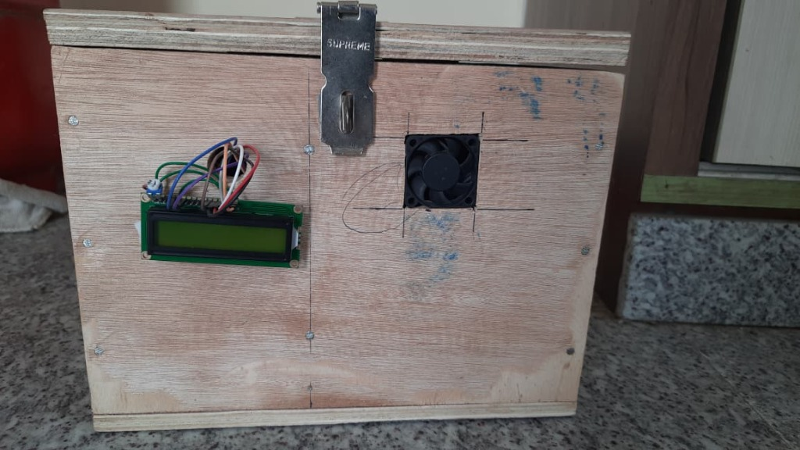
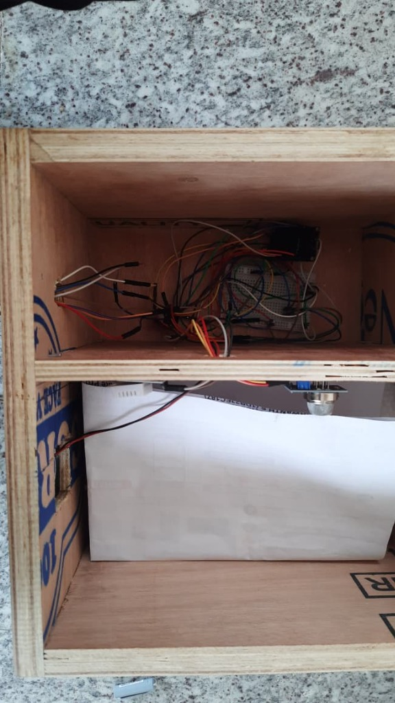
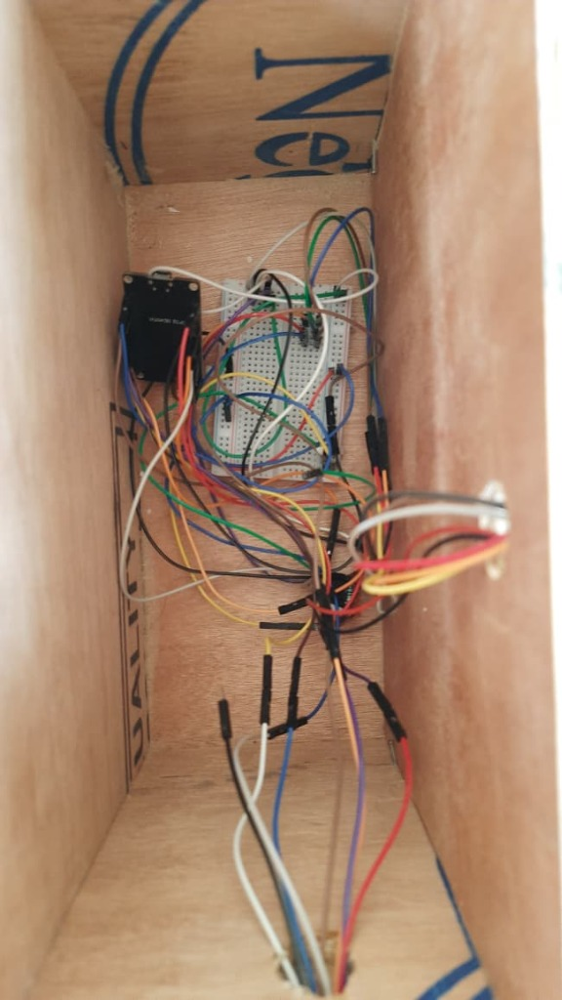

# AgroBridge 🌱

AgroBridge is an IoT-enabled agricultural marketplace and smart cold-storage monitoring platform built with React Native (Expo), Supabase, ESP32, and ESP32-CAM. By eliminating middlemen, AgroBridge connects farmers directly with buyers and backs produce listings with live environmental telemetry, automated spoilage mitigation, warehouse camera snapshots, government Mandi price benchmarks, and escrow-protected orders.

> 📱 **Android App Release:** Download the latest prebuilt APK from the [GitHub Releases](https://github.com/YashasR1/AgroBridge/releases/latest) page (`AgroBridge-release.apk`).

---

## 📸 Smart Storage Hardware Prototype

The AgroBridge IoT unit is housed in a custom dual-compartment wooden enclosure that isolates the microcontroller electronics from the crop storage chamber while providing local status readouts and automated active ventilation.

### 1. Front Enclosure, 1602 LCD & Exhaust Fan

*Front exterior of the latched wooden storage unit featuring a panel-mounted 16×2 character LCD (displaying live temperature, humidity, gas PPM, fan state, and `AUTO`/`MANUAL` mode) alongside an automated exhaust cooling fan.*

### 2. Dual-Compartment Interior (Electronics Bay & Storage Chamber)

*Top-down interior view showing the partitioned design: the upper compartment houses the controller and wiring, while the lower crop storage chamber contains the DHT22 temperature/humidity sensor, MQ gas sensor module for spoilage detection, and ventilation fan aperture.*

### 3. Electronics Bay & Sensor Wiring Harness

*Inside the upper electronics compartment showing the ESP32 microcontroller, solderless breadboard distribution, and color-coded jumper harness routing to the front 1602 LCD, fan control relay (`GPIO 18`), and lower-chamber sensors.*

---

## 🌟 Key Features

### 1. Dual-Sided Marketplace (B2C, B2B & Guest Mode)
- **Role-Based Workflows:** Dedicated dashboards for **Farmers** (crop listings, IoT telemetry, camera feed, order management) and **Buyers** (category filtering, sorting by price/distance, checkout).
- **Farmer-to-Farmer (B2B):** Farmers can also purchase supplies from other farmers.
- **Guest Exploration:** Guest mode lets users preview both Farmer and Buyer experiences without full onboarding.
- **Live Inventory Engine:** Atomic server-side stock deduction via the `decrement_crop_quantity` PostgreSQL RPC (`SECURITY DEFINER`) prevents overselling.

### 2. Escrow Payments & Order Lifecycle
- **Protected Checkout:** Orders move through `pending` → `escrow_locked` → `shipped` → `delivered` → `completed` states.
- **Stripe Connect & Manual Capture Escrow:** `stripe-integration` and `stripe-webhook` Edge Functions support Stripe Express onboarding and manual-capture escrow holds alongside the in-app mock payment workflow.
- **Buyer-Confirmed Release:** Only the buyer who placed the order can confirm delivery and release escrow funds to the seller.

### 3. Real-Time Chat, Negotiation & Notifications
- **Live Order Chat:** Powered by Supabase Realtime WebSocket channels (`messages`), enabling direct negotiation between buyers and farmers.
- **Push & In-App Alerts:** `expo-notifications` and toast banners notify users of incoming negotiation messages, order dispatches, escrow releases, and critical warehouse spoilage spikes.

### 4. IoT Cold-Storage Telemetry & ESP32-CAM Monitoring
- **ESP32 Gateway (`agrobridge-gateway`):**
  - Reads **DHT22** (temperature & humidity on `GPIO 4`) and an **MQ gas sensor** (`GPIO 34`) every 10 seconds and updates the local **1602 parallel LCD**.
  - Authenticates payloads to Supabase (`ingest-telemetry`) using **HMAC-SHA256** (`x-device-signature`) and NTP timestamps for anti-replay protection.
  - Automatically forces the exhaust cooling fan (`GPIO 18`) **ON** when gas reaches **≥ 1000 PPM**, temperature reaches **≥ 35.0°C**, or humidity reaches **≥ 80.0%**; otherwise syncs with the farmer's remote toggle in the app (or local Serial Monitor `ON`/`OFF`/`AUTO`/`TEST` overrides).
- **ESP32-CAM Visual Monitor (`agrobridge-cam`):**
  - Captures JPEG snapshots (SVGA `800×600` with PSRAM, QVGA fallback) every 10 seconds and uploads them with HMAC-SHA256 headers (`x-device-id`, `x-device-timestamp`, `x-device-signature`) to `ingest-camera-snapshot`.
  - Stores snapshots in the `warehouse-snapshots` Supabase Storage bucket and updates `storage_telemetry` for live viewing in the Farmer Dashboard.
- **Critical Spoilage Alerts:** Warehouse gas levels ≥ 1000 PPM trigger immediate high-priority toast and push alerts in the mobile app.

### 5. Live Mandi Benchmarks & Multilingual Support
- **Mandi Price Sync:** The `fetch-mandi-prices` Edge Function syncs Karnataka commodity rates (modal, min, and max prices converted to ₹/kg) from `data.gov.in` (with fallback market targets) and feeds `react-native-chart-kit` price trends.
- **7-Language UI Localization:** Built with `react-i18next` supporting **English (`en`)**, **Hindi (`hi`)**, **Kannada (`kn`)**, **Tamil (`ta`)**, **Telugu (`te`)**, **Marathi (`mr`)**, and **Malayalam (`ml`)**, paired with the `translate-crop` Edge Function for dynamic crop name translation.

---

## 🛠️ Tech Stack

- **Mobile App:** React Native, Expo (`~56.0`), NativeWind (Tailwind CSS), React Navigation, Moti, `react-native-chart-kit`, `react-i18next`, `expo-notifications`
- **Backend & Database:** Supabase (Auth, PostgreSQL with Row Level Security & RPCs, Realtime Channels, Storage, Deno/TypeScript Edge Functions)
- **Payments:** Stripe Connect / Checkout (manual-capture escrow) & in-app mock escrow checkout
- **IoT Hardware & Firmware:** ESP32 DevKit, ESP32-CAM (AI-Thinker OV2640), DHT22 sensor, MQ gas sensor, 1602 LCD, relay-controlled cooling fan (`C++` / Arduino)

---

## 📂 Project Structure

```text
AgroBridge/
├── agrobridge-app/                 # React Native (Expo) mobile app
│   ├── android/                    # Native Android Gradle project
│   └── src/
│       ├── components/             # CustomToast, SensorCard
│       ├── config/                 # Supabase client configuration
│       ├── context/                # AuthContext & role/session state
│       ├── i18n/                   # Locales (en, hi, kn, ml, mr, ta, te)
│       ├── navigation/             # AppNavigator, BuyerStack, FarmerStack, MainTabNavigator
│       ├── screens/                # Auth, Buyer, Farmer, Guest, Chat, Profile, Language screens
│       └── utils/                  # Mandi price fetcher, notifications, translation helpers
├── agrobridge-backend/             # Supabase project config & serverless functions
│   └── supabase/
│       └── functions/
│           ├── fetch-mandi-prices/
│           ├── ingest-camera-snapshot/
│           ├── ingest-telemetry/
│           ├── stripe-integration/
│           ├── stripe-webhook/
│           └── translate-crop/
├── agrobridge-cam/                 # ESP32-CAM snapshot capture & upload firmware
├── agrobridge-gateway/             # ESP32 DHT22/MQ sensor, 1602 LCD & fan relay firmware
├── docs/
│   └── images/                     # Hardware prototype photos
└── supabase_schema.sql             # PostgreSQL schema, RLS policies, RPCs & storage buckets
```

---

## 🔒 Security & Architecture

- **PostgreSQL Row Level Security (RLS):**
  - Users can only view/update their own profiles (`users`) and linked IoT devices (`hardware_installations`).
  - Farmers manage only their own `crops`; buyers see only their orders (`orders`), while farmers see orders for their listed crops.
  - Messages (`messages`) are readable only by sender or receiver.
  - `decrement_crop_quantity` runs as `SECURITY DEFINER` so buyers cannot directly mutate crop inventory.
- **Hardware Request Signing:** Both `agrobridge-gateway` and `agrobridge-cam` sign requests using **HMAC-SHA256** and NTP Unix timestamps, verified server-side within a 5-minute anti-replay window before updating `storage_telemetry` or `warehouse-snapshots`.

---

## 🚀 Getting Started

### Prerequisites
- Node.js & npm
- Expo CLI / Android SDK (for building locally)
- A Supabase project
- Arduino IDE / PlatformIO (if flashing ESP32 & ESP32-CAM firmware)

### 1. Database & Storage Setup
Run [`supabase_schema.sql`](supabase_schema.sql) in your Supabase SQL Editor to create all tables (`users`, `storage_telemetry`, `hardware_installations`, `crops`, `orders`, `messages`, `mandi_prices`), RLS policies, the `decrement_crop_quantity` RPC, and the `warehouse-snapshots` storage bucket.

### 2. Deploy Supabase Edge Functions
From `agrobridge-backend/`, deploy the Edge Functions (`ingest-telemetry`, `ingest-camera-snapshot`, `fetch-mandi-prices`, `translate-crop`, `stripe-integration`, `stripe-webhook`) and configure required environment secrets (`DATA_GOV_API_KEY`, `STRIPE_SECRET_KEY`, etc.).

### 3. Run the Mobile App
```bash
cd agrobridge-app
npm install
npm start
```
Configure your Supabase URL/Anon Key in `agrobridge-app/.env` (or `src/config/supabase.js`), then open the app in Expo Go, an emulator, or install the prebuilt Android APK from [Releases](https://github.com/YashasR1/AgroBridge/releases/latest).

### 4. Flash the IoT Hardware (Optional)
- Update Wi-Fi credentials, your Supabase function URLs, `DEVICE_ID`, and `SECRET_KEY` in [`agrobridge-gateway/agrobridge-gateway.ino`](agrobridge-gateway/agrobridge-gateway.ino) and [`agrobridge-cam/agrobridge-cam.ino`](agrobridge-cam/agrobridge-cam.ino).
- Flash the gateway sketch to the ESP32 and the camera sketch to the AI-Thinker ESP32-CAM, then link the matching `DEVICE_ID` inside the Farmer Dashboard.
